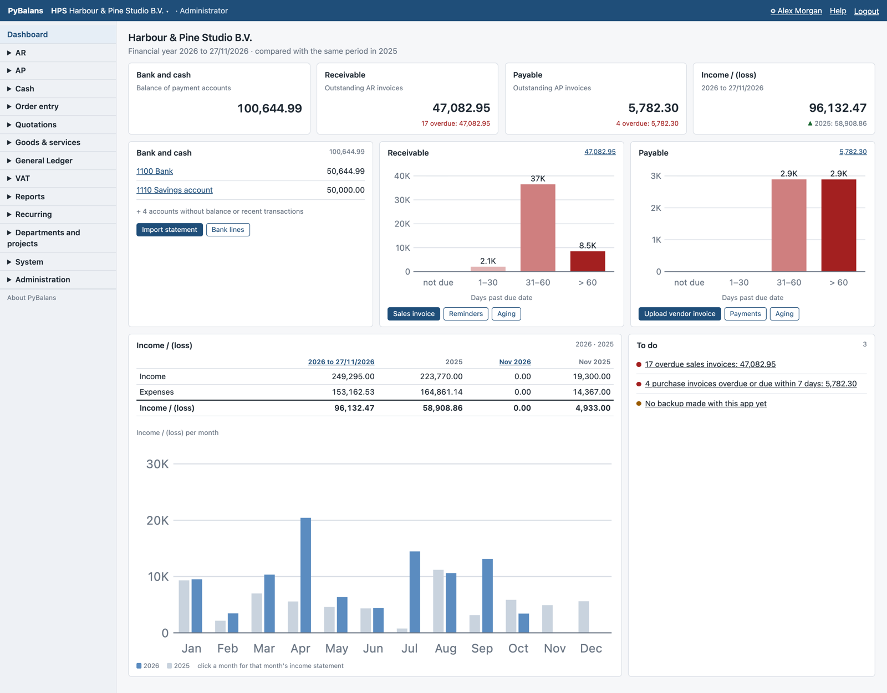
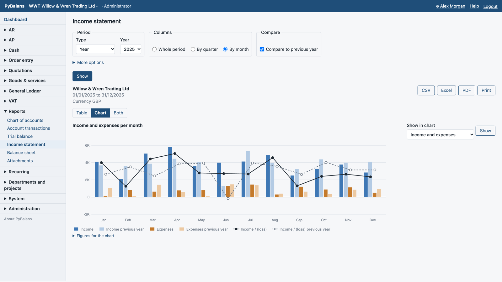
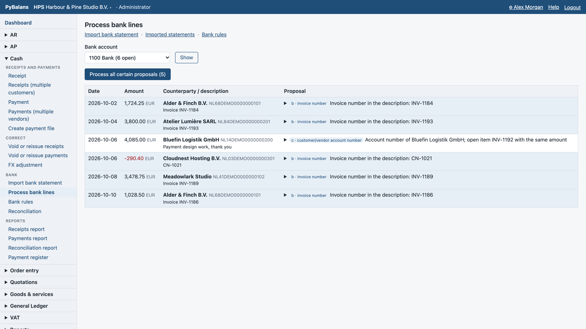
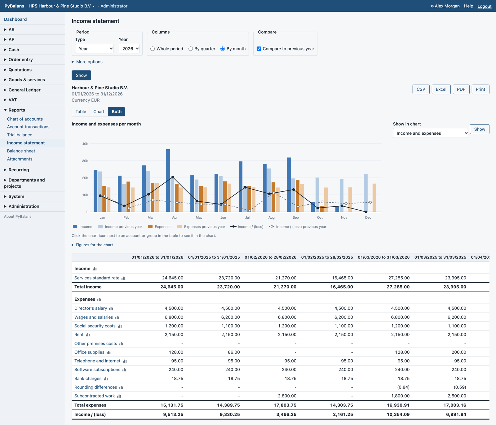
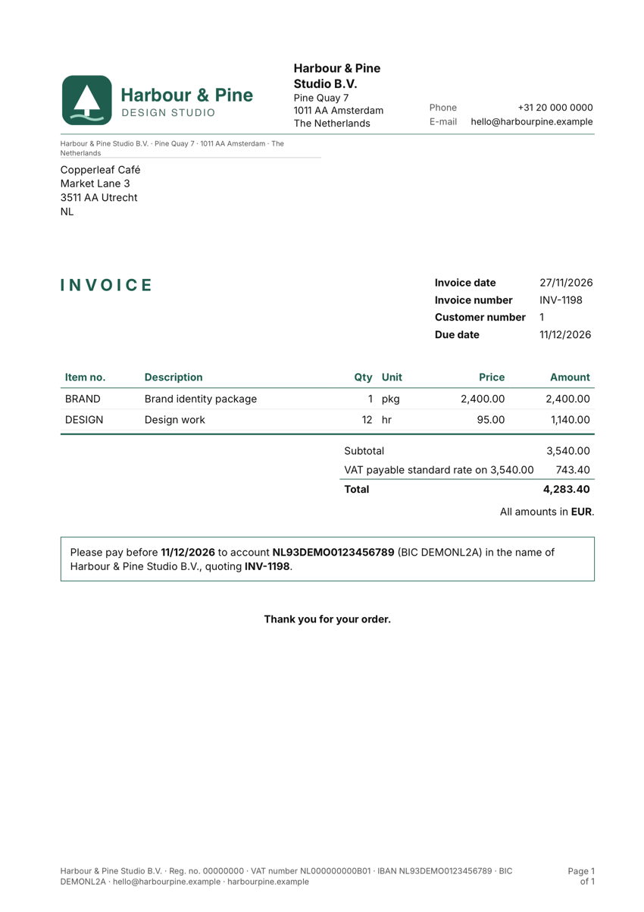
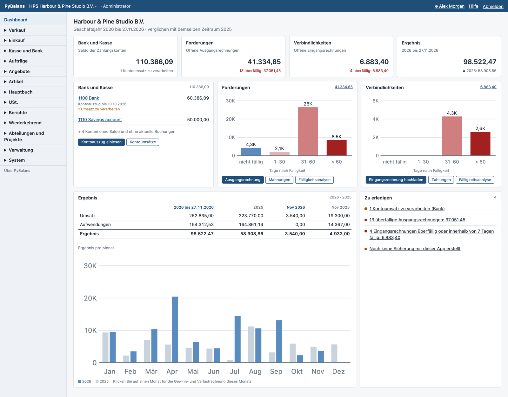

# PyBalans

*Bookkeeping in Python on PostgreSQL · reads and enhances SQL-Ledger companies*

This Python version by Matthijs Havinga · © 2026 · GPL-2.0-or-later. Based on SQL-Ledger, created by Dieter Simader
(DWS Systems Inc.); all credit for SQL-Ledger and its licence goes to him.

PyBalans is a web application for double-entry bookkeeping. It is a rewrite in Python of
[SQL-Ledger](https://www.sql-ledger.com) 3.2.12 (Perl) and works on the **existing SQL-Ledger database schema**: you
can open an SQL-Ledger company in PyBalans, or read in an SQL-Ledger backup, and carry on from there. A company
upgraded by SQL-Ledger 4.x can be linked, but 4.x is **not supported** (use at your own risk). Backups of
**Run my Accounts** and ledger123 (forks of SQL-Ledger 2.8) can be read in too; see
[`TESTING-RMA.md`](TESTING-RMA.md).

PyBalans is not affiliated with or endorsed by DWS Systems Inc., the maker of SQL-Ledger. See [`NOTICE.md`](NOTICE.md).

[](https://www.youtube.com/watch?v=sJrrHXZSLnw)

*Click the image for a 2-minute demo on YouTube. All names and figures in the screenshots are made up.*

| | |
|---|---|
|  |  |
| Reading an SQL-Ledger backup: the check report | Processing bank statement lines with proposals |
|  |  |
| Profit and loss, with chart | A sales invoice as PDF |
|  | |
| The same dashboard in German | |

## Status

Version 1.4.0. Made by Matthijs Havinga and used by the author for their own bookkeeping since October 2026, after moving
off SQL-Ledger. It has been built and checked feature by feature against the original Perl code: the `compare/`
tools run the same operations through SQL-Ledger and PyBalans on the same database and compare the results.
Deliberate differences from SQL-Ledger are listed in [`docs/TECHNISCH.md`](docs/TECHNISCH.md) ("Bewuste afwijkingen").

The program and its screens are available in **Dutch, English, German and French**. Most of the documentation
(technical description and the design notes in [`docs/`](docs/)) is in **Dutch**.

## What it does

- General ledger, chart of accounts, journal entries, recurring entries, year-end closing.
- Sales and purchase invoices (with and without items), orders and quotations, payments, reminders and statements.
- Bank statements (CAMT.053 and MT940): read in, match to invoices by payment reference, invoice number or the
  contact's IBAN, and reconcile (also several lines or transactions together). Without an IBAN on the contact
  you get a booking proposal (similar name and amount, or as booked before) that you confirm yourself.
- Reports: trial balance, income statement, balance sheet, aging, VAT; PDF and spreadsheet export.
- Dutch VAT return and EU sales listing (ICP) overviews; standard charts of accounts for the Netherlands (with
  RGS mapping), Switzerland, the United Kingdom, France and Belgium.
- Invoice layout with your own logo and style; attachments (PDF upload of purchase invoices); timesheets.
- Users with roles and mandatory two-factor authentication; several companies per installation; audit trail.
- Backups of all companies, and reading in SQL-Ledger and Run my Accounts / ledger123 backups (`.sql`, `.gz`,
  `.bz2`), with a check report and a check list for switching over.

Not ported from SQL-Ledger: point of sale, payroll, warehouses, kits, and a few order functions (see
[`docs/TECHNISCH.md`](docs/TECHNISCH.md)).

## Installing

Requirements: Python 3.12 or later, PostgreSQL 15 or later, and for PDF documents the Pango libraries used by
WeasyPrint.

**With Docker** (app and database together, reachable on `127.0.0.1:8000`):

```bash
echo 'a-strong-password' > db_password.txt
docker compose up -d
docker compose logs app
```

The log shows a one-time start code. Open <http://127.0.0.1:8000/welkom> in the browser and follow the first-start
wizard: language, administrator with two-factor authentication, first company (new, import a backup, or an existing
SQL-Ledger database), users. Uploaded files, attachments and templates are kept in the volume `appdata`; the database
in `pgdata`. If port 8000 is taken, change it in `compose.yaml`. For use on a server, put an HTTPS proxy (for example Caddy) in front of it.

**With pip** (your own PostgreSQL):

```bash
python3 -m venv venv
venv/bin/pip install ".[web]"
venv/bin/pybalans --config app.toml serve
```

with an `app.toml` such as:

```toml
app_dsn = "host=127.0.0.1 user=sqlledger dbname=sqlledger_app"
db_host = "127.0.0.1"
db_user = "sqlledger"
```

The database user needs the CREATEDB privilege; the password can be given in a file via
`SQLLEDGER_DB_PASSWORD_FILE`. `pybalans --help` lists the other commands (`backup`, `create-admin`, …).

## Tests

```bash
pip install ".[web,test]"
pytest tests/
```

The database tests need a PostgreSQL server where they may create and drop databases (`SQLLEDGER_TEST_DSN`, by
default `host=127.0.0.1 port=55432 user=postgres`) and a template database `sl_template`: an SQL-Ledger company
filled with `compare/seed.sql`, `compare/report_seed.sql` and `compare/arap_seed.sql`. Without a reachable database
they are skipped; see `tests/conftest.py`. The comparison tools in `compare/` also need a local copy of SQL-Ledger
3.2.12, which is not included.

## Developing with Claude

The file [`CLAUDE.md`](CLAUDE.md) is the full working brief for developing PyBalans with an AI assistant: what the
project is, how the code is organised, and the rules (analyse first with numbered decision points, match SQL-Ledger,
never use real bookkeeping data, every screen text in Dutch, English, German and French, help per screen, full test
suite before you are done, nothing pushed without approval).

To continue with [Claude Code](https://claude.com/claude-code):

1. Clone the repository and set up the tests as described under *Tests* (a test PostgreSQL and the template database).
2. Start Claude Code in the repository folder (`claude` in a terminal, or open the folder in the desktop app). It
   reads `CLAUDE.md` automatically; you do not need to paste it.
3. Give it one task at a time, for example:
   - "Read CLAUDE.md and docs/TECHNISCH.md, then give me a short overview of how a bank statement is imported and
     matched."
   - "I want to install PyBalans on Ubuntu 24.04 without Docker. Analyse what is needed and give me numbered
     decision points with a recommendation; do not write code yet."
   - "Run the full test suite and report the result."
4. Approve or change the decision points, then let it build on its own branch. Review the diff and the test result
   before you merge.

With another assistant: give it the contents of `CLAUDE.md` as its first instruction.

## Layout

| Path | What |
|---|---|
| `sqlledger/` | the bookkeeping library (no screens): ledger logic ported from SQL-Ledger's `SL/*.pm` |
| `sqlledger_web/` | the web application (FastAPI, server-side HTML, HTMX) |
| `tests/` | pytest tests |
| `compare/` | side-by-side comparison with the original Perl code |
| `dev/` | development helpers |
| `docs/` | technical description and design notes (Dutch) |

## Licence

GNU General Public License, version 2 or (at your option) any later version — see [`COPYING`](COPYING). PyBalans is
derived from SQL-Ledger © DWS Systems Inc.; what was derived from where is listed in [`NOTICE.md`](NOTICE.md).
